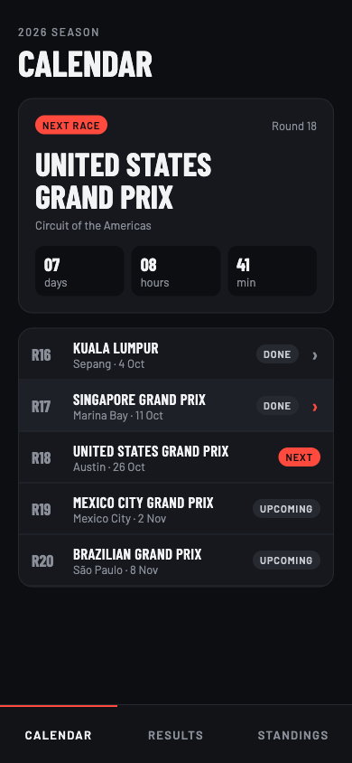
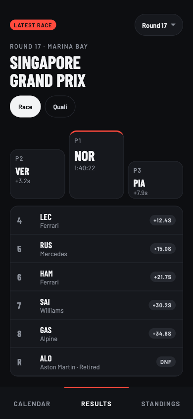
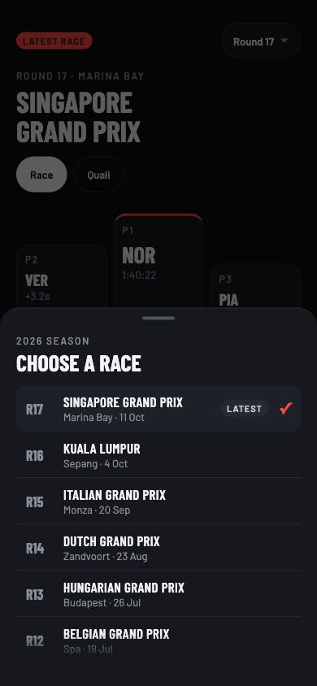
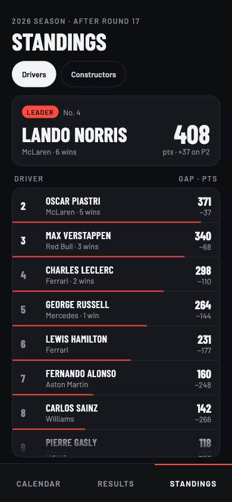
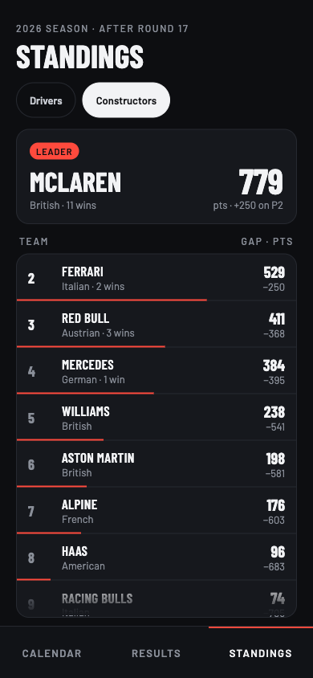

# Formula One

![Formula One header][header]

![coverage][coverage_badge]
[![style: very good analysis][very_good_analysis_badge]][very_good_analysis_link]
[![License: MIT][license_badge]][license_link]

A Formula One companion app built with [Flutter][flutter_link]: the season calendar with a countdown to the next race, the results of any completed race, and the drivers' and constructors' championship standings. Data comes from the [Jolpica F1 API][jolpica_link], and every response is stored on the device, so what you have opened keeps working offline.

_Generated by the [Very Good CLI][very_good_cli_link] 🤖_

---

## Features

- **Calendar**: every race of the season, with a countdown to the next one.
- **Results**: the podium and full classification of the latest race, with a picker for any completed round.
- **Standings**: drivers' and constructors' championships, with points, wins and the gap to the leader.
- **Offline cache**: responses are stored locally with a time-to-live, and expired data is still shown when the network or the server is down.

<table>
  <tr>
    <td></td>
    <td></td>
    <td></td>
    <td></td>
    <td></td>
  </tr>
</table>

---

## Architecture 🏗️

The app follows [Very Good architecture][very_good_architecture_link]: each layer only knows the one below it, and every layer lives in its own package.

```
bloc / UI (lib/)  →  formula_one_repository  →  api_client  →  response_cache  →  storage
                                                                                    ↑
                                                                          persistent_storage
```

| Package                                            | What it does                                                                |
| -------------------------------------------------- | --------------------------------------------------------------------------- |
| [`api_client`][api_client]                         | Talks to the Jolpica API and turns responses into typed models and failures |
| [`formula_one_repository`][formula_one_repository] | The single source of Formula One data for the blocs                         |
| [`response_cache`][response_cache]                 | Serves stored responses and goes to the network only when needed            |
| [`storage`][storage]                               | A small key/value storage interface                                         |
| [`persistent_storage`][persistent_storage]         | Implements `storage` on a [Drift][drift_link] (SQLite) database             |

---

## Getting Started 🚀

This project contains 3 flavors:

- development
- staging
- production

To run the desired flavor either use the launch configuration in VSCode/Android Studio or use the following commands:

```sh
# Development
$ flutter run --flavor development --target lib/main_development.dart

# Staging
$ flutter run --flavor staging --target lib/main_staging.dart

# Production
$ flutter run --flavor production --target lib/main_production.dart
```

_\*Formula One works on iOS, Android, Web, and Windows._

---

## Running Tests 🧪

To run all unit and widget tests use the following command:

```sh
$ very_good test --coverage --test-randomize-ordering-seed random
```

To view the generated coverage report you can use [lcov](https://github.com/linux-test-project/lcov).

```sh
# Generate Coverage Report
$ genhtml coverage/lcov.info -o coverage/

# Open Coverage Report
$ open coverage/index.html
```

---

## Bloc Lints 🔍

This project uses the [bloc_lint](https://pub.dev/packages/bloc_lint) package to enforce best practices using [bloc](https://pub.dev/packages/bloc).

To validate linter errors, run

```bash
dart run bloc_tools:bloc lint .
```

You can also validate with VSCode-based IDEs using the [official bloc extension](https://marketplace.visualstudio.com/items?itemName=FelixAngelov.bloc).

To learn more, visit https://bloclibrary.dev/lint/

---

## Working with Translations 🌐

This project follows the [official internationalization guide for Flutter][internationalization_link] using [ARB files][arb_documentation_link] for translations.

### Adding Strings

1. To add a new localizable string, open the `app_en.arb` file at `lib/l10n/arb/app_en.arb` and add a new key/value pair with the relevant description (optional):

```arb
{
    "@@locale": "en",
    "counterAppBarTitle": "Counter",
    "@counterAppBarTitle": {
        "description": "Text shown in the AppBar of the Counter Page"
    },
    "helloWorld": "Hello World",
    "@helloWorld": {
        "description": "Hello World greeting."
    }
}
```

1. Use the new string:

```dart
import 'package:formula_one/l10n/l10n.dart';

@override
Widget build(BuildContext context) {
  final l10n = context.l10n;
  return Text(l10n.helloWorld);
}
```

### Adding Supported Locales

Update the `CFBundleLocalizations` array in the `Info.plist` at `ios/Runner/Info.plist` to include the new locale.

```xml
    ...

    <key>CFBundleLocalizations</key>
	<array>
		<string>en</string>
		<string>es</string>
	</array>

    ...
```

### Adding Translations

1. For each supported locale, add a new ARB file in `lib/l10n/arb`:

```
├── l10n
│   ├── arb
│   │   ├── app_en.arb
│   │   └── app_es.arb
```

1. Add the translated strings to the new `.arb` file:

`app_es.arb`

```arb
{
    "@@locale": "es",
    "counterAppBarTitle": "Contador",
    "@counterAppBarTitle": {
        "description": "Texto mostrado en la AppBar de la página del contador"
    },
    "helloWorld": "Hola Mundo",
    "@helloWorld": {
        "description": "Saludo Hola Mundo."
    }
}
```

### Generating Translations

To use the latest translations changes, you will need to generate them:

```sh
flutter gen-l10n --arb-dir="lib/l10n/arb"
```

Alternatively, run `flutter run` and code generation will take place automatically.

[header]: design/formula-one-header.png
[flutter_link]: https://flutter.dev
[jolpica_link]: https://github.com/jolpica/jolpica-f1
[coverage_badge]: coverage_badge.svg
[drift_link]: https://drift.simonbinder.eu
[internationalization_link]: https://docs.flutter.dev/ui/internationalization
[arb_documentation_link]: https://github.com/google/app-resource-bundle
[license_badge]: https://img.shields.io/badge/license-MIT-blue.svg
[license_link]: https://opensource.org/licenses/MIT
[very_good_analysis_badge]: https://img.shields.io/badge/style-very_good_analysis-B22C89.svg
[very_good_architecture_link]: https://verygood.ventures/blog/very-good-flutter-architecture
[very_good_analysis_link]: https://pub.dev/packages/very_good_analysis
[very_good_cli_link]: https://github.com/VeryGoodOpenSource/very_good_cli
[api_client]: packages/api_client/
[formula_one_repository]: packages/formula_one_repository/
[response_cache]: packages/response_cache/
[storage]: packages/storage/storage/
[persistent_storage]: packages/storage/persistent_storage/
